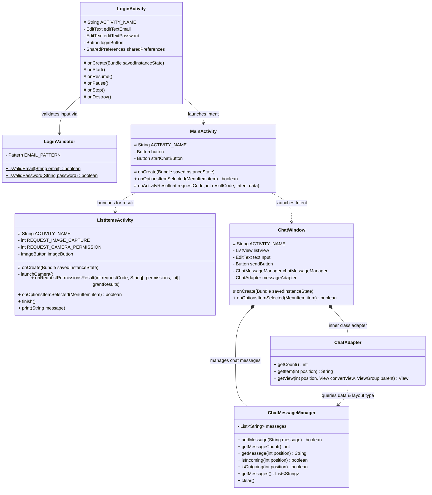

# Class Diagram - Android Assignments Application

The following class diagram outlines the architecture and components of the application, including activities, standalone logic helper classes, adapters, and layout relationships.

## Overview of Classes

### Activities
- **`LoginActivity`**: Serves as the launcher entry point of the app. Handles user credentials input, restores saved email from `SharedPreferences`, delegates email/password validation to `LoginValidator`, saves default email on success, and navigates to `MainActivity`.
- **`MainActivity`**: Central navigation hub. Provides options to navigate to `ListItemsActivity` (expecting a result) and `ChatWindow`. Handles result toasts returned from `ListItemsActivity`. Uses `NavUtils` for Up navigation back to parent `LoginActivity`.
- **`ListItemsActivity`**: Displays interactive UI controls: an `ImageButton` for camera capture with permission checks (`CAMERA`), a `Switch` showing state toasts, and a `CheckBox` triggering a confirmation dialog that finishes the activity with a result back to `MainActivity`.
- **`ChatWindow`**: Hosts the chat user interface with an `EditText`, `sendButton`, and `ListView`. Uses `ChatMessageManager` for message collection and `ChatAdapter` for displaying incoming/outgoing row layouts.

### Logic Helpers (Decoupled Business Logic)
- **`LoginValidator`**: Pure Java static utility providing email regex matching and password validation rules without Android SDK dependencies, enabling 100% unit test coverage on JVM.
- **`ChatMessageManager`**: Decoupled domain class managing chat message list state, ignoring blank/empty messages, and calculating alternating row layout types (`isIncoming` vs `isOutgoing`), enabling 100% unit test coverage.
